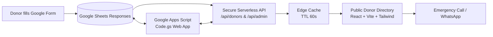

# Blood PM Brozz 🩸

> **Emergency Blood Donor Directory & Community Coordination Platform for Kerala**

Blood PM Brozz is a production-ready, publicly accessible, mobile-first web application designed to connect voluntary blood donors with individuals and hospitals during critical medical emergencies across all 14 districts of Kerala.

---

## 🌟 Key Features

### 1. 🔍 Searchable Emergency Blood Donor Directory
- **Blood Group Filters:** Filter across all 8 major blood groups (`A+`, `A-`, `B+`, `B-`, `AB+`, `AB-`, `O+`, `O-`) with real-time count badges.
- **Kerala District Filter:** Quickly find donors in any of Kerala's 14 districts (*Alappuzha, Ernakulam, Idukki, Kannur, Kasaragod, Kollam, Kottayam, Kozhikode, Malappuram, Palakkad, Pathanamthitta, Thiruvananthapuram, Thrissur, Wayanad*).
- **Live Availability Toggle:** Instant toggle between *"Available Now in Kerala"* and *"Resting / Currently Unavailable"*.
- **Search Bar:** Real-time search by donor name or specific town/locality.

### 2. 📞 Privacy-Respecting Contact Channels
- **One-Touch Direct Call:** `tel:` button connects immediately to willing donors.
- **One-Touch WhatsApp:** Opens WhatsApp with a pre-filled emergency request template specifying the required blood group.
- **Strict Privacy & Consent Enforcement:** Phone numbers and WhatsApp links are displayed **only** with explicit donor consent. If consent is revoked, contact details are completely stripped by the backend.
- **Donor Self-Management:** Any donor can request to update their information, mark themselves as "Resting", or permanently remove their listing.

### 3. 🧬 Blood Compatibility & Educational Guide
- **Interactive Compatibility Matrix:** Visual matcher showing exactly who can donate to whom and who can receive from whom.
- **Universal Donor & Recipient Highlights:** Clear callouts for **O-** (Universal Donor) and **AB+** (Universal Recipient).
- **Donor Eligibility Guidelines:** Weight, age, hemoglobin, rest intervals, and clinical deferrals.
- **Healthcare & Medical Disclaimer:** Explicit notice that clinical screening, cross-matching, and health evaluations must be conducted by certified healthcare professionals and blood banks.

### 4. 📊 Live Statistics Strip
- Real-time calculated counters showing total registered life-savers, donors available right now, blood group distributions, and active districts.

### 5. 🛡️ Protected Admin Dashboard
- **Backend Authentication:** Enforces secure passcode verification on the server (`/api/admin`).
- **Comprehensive Registry:** View all registrations (Approved, Pending Review, Rejected, Deactivated) including raw contact details, timestamps, and notes.
- **Moderation Actions:**
  - One-click Approve / Reject.
  - One-click Toggle Availability (Available / Resting).
  - One-click Toggle Phone & WhatsApp public consent.
  - Deactivate / soft delete records.
- **Export & Sync:** One-click CSV export and instant live re-sync with the Google Sheet.

---

## 🏗️ Architecture & Data Workflow



1. **Google Form:** Donors register their details via the official [Google Form](https://docs.google.com/forms/d/e/1FAIpQLSdvTzN2DwFIvEb2UxeTO970ZaS0Be4F_vqXKbfPNzJEXc9_fw/viewform?usp=dialog).
2. **Google Sheet:** Responses are automatically recorded in the [Google Spreadsheet](https://docs.google.com/spreadsheets/d/1zDtsboLMoDs8NMgDqmUFxedtULj5HasnXsCQdSXGVI0/edit?usp=sharing).
3. **API Normalization Layer (`api/utils.js` & `api/donors.js`):**
   - Automatically sanitizes blood groups (`O+VE` -> `O+`, `B positive` -> `B+`).
   - Normalizes phone numbers to standard format (`+91...`).
   - Maps "Same" WhatsApp responses to the primary mobile number.
   - Strictly enforces consent policies before exposing contacts.
4. **Edge Caching:** Caches public responses with `s-maxage=30, stale-while-revalidate=60` to guarantee lightning-fast load times and eliminate Google Sheets rate-limiting.

---

## 💻 Technology Stack

- **Frontend:** React 19, Vite 8, Tailwind CSS v4, Lucide React icons
- **Backend:** Vercel Serverless Functions (`/api/donors`, `/api/admin`) + Vite dev middleware
- **Database:** Google Sheets
- **Automation:** Google Apps Script (`apps-script/Code.gs`)
- **Hosting / DevOps:** Vercel & GitHub

---

## 🚀 Getting Started Locally

### Prerequisites
- Node.js (v18 or higher)
- npm (v9 or higher)

### Installation
```bash
# Clone the repository
git clone https://github.com/musammilvilayil/bloodpmbrozz.git
cd bloodpmbrozz

# Install dependencies
npm install

# Start development server
npm run dev
```

Visit `http://localhost:5173/` in your browser. Both the frontend and `/api` serverless routes are automatically served by the local Vite dev middleware!

### Running Automated Tests
```bash
# Run unit and live integration tests
node test/integration.test.js
```

### Production Build
```bash
npm run build
```

---

## 🔐 Admin Authentication

The admin dashboard is accessible from the top navigation bar or footer.
- **Default Evaluation Passcode:** `BloodPM@Brozz2026!`
- Can be customized in production via the `ADMIN_PASSWORD` environment variable.

---

## ⚙️ Google Apps Script Integration (`apps-script/Code.gs`)

To enable two-way write-back directly into your Google Sheet from the Admin Dashboard:

1. Open your [Google Sheet](https://docs.google.com/spreadsheets/d/1zDtsboLMoDs8NMgDqmUFxedtULj5HasnXsCQdSXGVI0/edit).
2. Click **Extensions > Apps Script**.
3. Replace the editor contents with the code located in [`apps-script/Code.gs`](file:///C:/Users/vilay/.gemini/antigravity-ide/scratch/bloodpmbrozz/apps-script/Code.gs).
4. Click **Deploy > New deployment**, select **Web app**.
   - *Execute as:* **Me**
   - *Who has access:* **Anyone**
5. Copy the deployment URL and add it as `GOOGLE_APPS_SCRIPT_URL` in your Vercel project environment variables.

---

## 🚢 Deployment to Vercel

### Option 1: Automatic GitHub Continuous Deployment (Recommended)
1. Push this repository to GitHub: `git push origin main`.
2. Go to [Vercel](https://vercel.com/new).
3. Import `musammilvilayil/bloodpmbrozz`.
4. Add environment variables:
   - `ADMIN_PASSWORD`: Your secret admin passcode.
   - `ADMIN_SECRET`: Secret token signature string.
   - `GOOGLE_APPS_SCRIPT_URL`: (Optional) Your Apps Script deployment URL.
5. Click **Deploy**. Vercel will build and assign your production domain.

### Option 2: CLI Deployment
```bash
npx vercel deploy --prod
```

---

## 📜 Medical & Privacy Notice

- **Health Disclaimer:** Blood PM Brozz provides emergency coordination assistance only. All transfusions and donor qualifications must be clinically tested and verified by licensed medical professionals and certified blood banks.
- **Emergency Numbers (Kerala):**
  - Ambulance: **108**
  - National Health Helpline: **104**
  - Emergency Blood Helpline: **0471-2528388**

---

© 2026 Blood PM Brozz Community.
